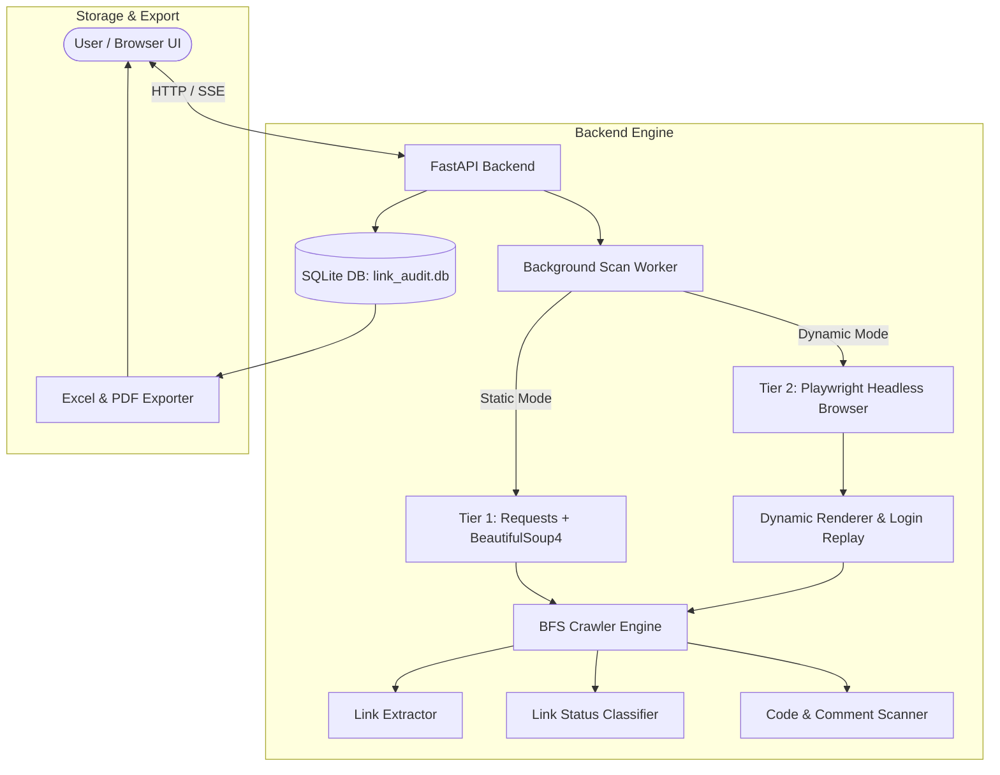

# Link & Navigation Audit Tool

A web auditing application designed to crawl target websites, identify broken and external links, analyze inline/internal code and comments, and generate audit reports in Excel and PDF formats.

---

## Project Overview

The **Link & Navigation Audit Tool** performs automated web crawling and code analysis to detect navigation defects and code artifacts:
- **Link Auditing**: Checks for broken URLs (404/500 errors), inactive anchor placeholders (`#`), IP-based internal links, and external/internet links.
- **Code & Comment Scanning**: Audits active inline/internal CSS and JS (`<style>`, `<script>`, `style="..."`, `on*="..."` handlers) as well as commented-out HTML link markup.
- **Dual Scanning Engines**: Supports **Static** (lightweight HTTP requests) and **Dynamic** (full headless browser rendering with Playwright) modes.
- **Recorded Login Replay**: Automates login flows for authenticated web applications.
- **Real-Time Progress**: Streams live scan metrics via Server-Sent Events (SSE).
- **Report Export**: Generates reports in `.xlsx` (Excel) and `.pdf` formats.

---

## 🏗 System Architecture



---

## Modules & Files Breakdown

### Backend ([`backend/app/`](file:///c:/Users/vvekp/Downloads/broken_link_tool/backend/app))

| File | Purpose |
| :--- | :--- |
| [`main.py`](file:///c:/Users/vvekp/Downloads/broken_link_tool/backend/app/main.py) | **API Entrypoint**: Defines FastAPI routes for scan management, login recording, SSE progress streaming, findings retrieval, and report exports. |
| [`crawler.py`](file:///c:/Users/vvekp/Downloads/broken_link_tool/backend/app/crawler.py) | **BFS Crawler**: Manages the breadth-first search crawl loop, enforces host scoping, enqueues navigable URLs, and coordinates scanning. |
| [`extractor.py`](file:///c:/Users/vvekp/Downloads/broken_link_tool/backend/app/extractor.py) | **Link Extractor**: Extracts HTML attributes (`href`, `src`, `action`), inline JS event handlers (`onclick`, `onload`), and CSS/JS URLs. |
| [`comment_scanner.py`](file:///c:/Users/vvekp/Downloads/broken_link_tool/backend/app/comment_scanner.py) | **Code & Comment Scanner**: Scans active inline/internal CSS & JS code (`<style>`, `<script>`, `style=""`, `on*=""`) and commented-out link markup. |
| [`classifier.py`](file:///c:/Users/vvekp/Downloads/broken_link_tool/backend/app/classifier.py) | **Link Classifier**: Categorizes extracted links as `broken`, `inactive` (`#`), `ip_based`, or `internet`. |
| [`link_checker.py`](file:///c:/Users/vvekp/Downloads/broken_link_tool/backend/app/link_checker.py) | **HTTP Checker**: Sends HTTP HEAD/GET requests to verify link status codes and handle redirects. |
| [`renderer.py`](file:///c:/Users/vvekp/Downloads/broken_link_tool/backend/app/renderer.py) | **Dynamic Renderer**: Manages Playwright Chromium sessions for JavaScript rendering and cookie management. |
| [`login_recorder.py`](file:///c:/Users/vvekp/Downloads/broken_link_tool/backend/app/login_recorder.py) | **Login Flow Recorder**: Launches interactive browser sessions to record user click and fill interactions for login automation. |
| [`login_replay.py`](file:///c:/Users/vvekp/Downloads/broken_link_tool/backend/app/login_replay.py) | **Login Replayer**: Replays saved click/fill steps in Playwright before scanning protected sites. |
| [`login_config_store.py`](file:///c:/Users/vvekp/Downloads/broken_link_tool/backend/app/login_config_store.py) | **Login Config Storage**: Saves and retrieves recorded login step JSON structures in SQLite. |
| [`scan_sessions.py`](file:///c:/Users/vvekp/Downloads/broken_link_tool/backend/app/scan_sessions.py) | **Progress Tracker**: In-memory state tracking for active scans (pages crawled, links checked, elapsed time, estimated time remaining). |
| [`db.py`](file:///c:/Users/vvekp/Downloads/broken_link_tool/backend/app/db.py) & [`schema.sql`](file:///c:/Users/vvekp/Downloads/broken_link_tool/backend/app/schema.sql) | **Database Layer**: SQLite schema definitions for `scans`, `findings`, and `login_configs`. |
| [`export.py`](file:///c:/Users/vvekp/Downloads/broken_link_tool/backend/app/export.py) | **Report Generator**: Exports audit results to multi-tab Excel workbooks (`openpyxl`) and formatted landscape PDFs (`reportlab`). |
| [`config.py`](file:///c:/Users/vvekp/Downloads/broken_link_tool/backend/app/config.py) | **Global Settings**: Configuration constants, IP validation, and timeout settings. |

### Frontend ([`frontend/`](file:///c:/Users/vvekp/Downloads/broken_link_tool/frontend))

| File | Purpose |
| :--- | :--- |
| [`index.html`](file:///c:/Users/vvekp/Downloads/broken_link_tool/frontend/index.html) | Single-page UI containing the scan form, login recording controls, real-time progress section, tabbed results table, and export buttons. |
| [`app.js`](file:///c:/Users/vvekp/Downloads/broken_link_tool/frontend/app.js) | Handles form validation, SSE event handling, login recording UI flows, tab switching, category filtering, and export triggering. |
| [`styles.css`](file:///c:/Users/vvekp/Downloads/broken_link_tool/frontend/styles.css) | Custom CSS styling for modern UI layout, badges, tabs, tables, and progress indicators. |

### Test Suite ([`test_site/`](file:///c:/Users/vvekp/Downloads/broken_link_tool/test_site))

| File | Purpose |
| :--- | :--- |
| [`server.py`](file:///c:/Users/vvekp/Downloads/broken_link_tool/test_site/server.py) | Lightweight stdlib HTTP server simulating a target app with login authentication, broken links, JS navigation, inline CSS/JS, and commented links. |

---

## UI & UX Flow

1. **Scan Configuration**:
   - User inputs a **Target URL** (e.g., `http://127.0.0.1:5050/`).
   - Selects **Site Type**:
     - `Static`: Fast HTTP-only crawl for traditional HTML apps.
     - `Dynamic`: Full browser execution via Playwright for SPAs or login-protected sites.
2. **Login Recording (Optional for Protected Sites)**:
   - If "This site requires login" is checked, the user can click **Record login flow**.
   - An automated browser opens, allowing the user to log in manually.
   - The tool records click/fill actions and saves the sequence for future automated scans.
3. **Live Progress Monitoring**:
   - Upon starting a scan, real-time metrics are streamed via SSE: pages crawled, links checked, elapsed time, and estimated remaining time.
4. **Results Inspection & Tab Navigation**:
   - **Links Tab**: Displays link findings with columns: `Found on page`, `Link`, `Category` (`Broken`, `Inactive`, `IP-based`, `Internet`), `Severity`, `Code snippet`, `Evidence / reason`, `Element location`.
   - **Code Findings Tab**: Displays code findings with columns: `Found On Page`, `Extracted Value / Target`, `Finding Type` (`Commented Link`, `Internal CSS`, `Inline CSS`, `Internal JS`, `Inline JS`), `Severity`, `Code Snippet`, `Details`, `DOM Location`.
   - **Category Filter Badges**: Clicking filter badges narrows findings to specific categories.
5. **Exporting Reports**:
   - Users can download Excel (`.xlsx`) workbooks or PDF (`.pdf`) documents.

---

## Getting Started

### 1. Installation

Ensure Python 3.9+ is installed, then install dependencies:

```bash
pip install -r requirements.txt
playwright install chromium
```

### 2. Run the Backend API

From the project root:

```bash
cd backend
uvicorn app.main:app 
```

The API server will run at `http://127.0.0.1:8000/`.

### 3. Run the Test Site (Optional)

In a separate terminal:

```bash
python test_site/server.py
```

The test site will run at `http://127.0.0.1:5050/` (Login: username `tester`, password `testpass123`).
